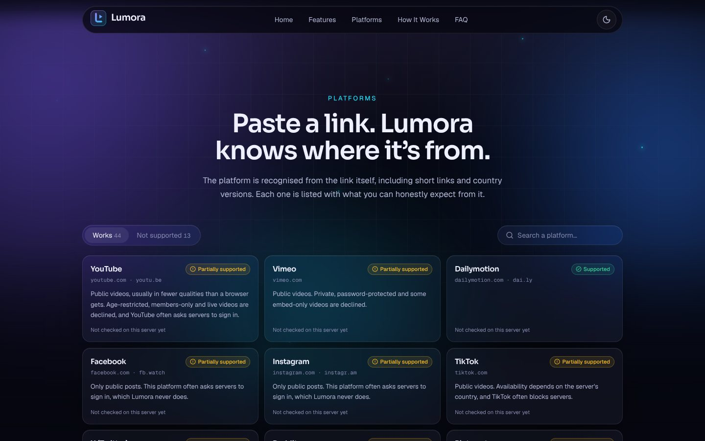
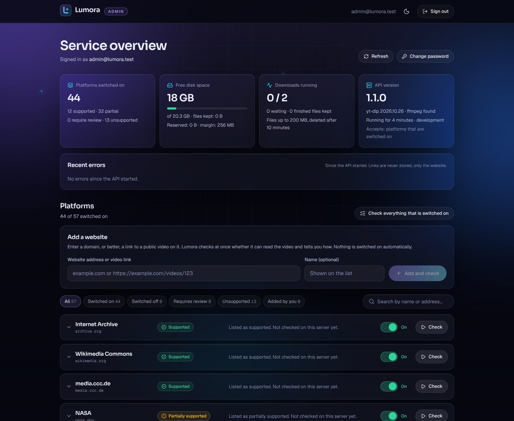

# Lumora

**Your Videos. Your Way.** Paste a link to a public video, choose a quality and subtitles, and download it.


Lumora is a complete application in two parts:

| Part | Folder | Built with | Runs on |
| --- | --- | --- | --- |
| Website | [`frontend/`](frontend) | React, TypeScript, Vite, Tailwind CSS, Framer Motion | Vercel (static) |
| API | [`backend/`](backend) | FastAPI, yt-dlp, FFmpeg | A server (systemd) or any container host |

The website is live at **<https://lumora-video.vercel.app>** and uses an API at `https://api.deephq.online`.
[Deploying](#deploying) explains how the two are hosted, connected and updated, and [Testing](#testing) how
the live site is checked.

## Contents

- [What it does](#what-it-does)
- [Platforms and source policy](#platforms-and-source-policy)
- [Admin panel](#admin-panel)
- [Run it locally](#run-it-locally)
- [Deploying](#deploying)
- [Configuration](#configuration)
- [How it works](#how-it-works)
- [Security](#security)
- [API](#api)
- [Testing](#testing)
- [Limits and scaling](#limits-and-scaling)
- [Troubleshooting](#troubleshooting)

## What it does

- **Recognises the platform** from the link while you type it, including short links (`youtu.be`, `fb.watch`)
  and country versions, and says what to expect: supported, partially supported, or not possible, and why.
- **Analyzes a link** and shows the title, preview image, duration and every quality the source really offers,
  with its format, codec and size. Nothing is invented: when a size is unknown it says so.
- **Downloads the quality you pick.** Sources that deliver video and audio separately are merged for you.
- **Subtitles.** Every published language is listed. Download a track as SRT or WebVTT, or embed tracks in the
  video file.
- **Real progress**: percentage, speed and time left as reported by the download, plus cancel at any moment.
- **Temporary files.** A finished file is deleted after a set time (30 minutes by default) or immediately with
  "Delete now". Nothing is kept after a restart.
- **Clear failures.** Private, paid, age-restricted, region-locked, DRM-protected and live content is declined
  with a specific message. So are invalid links, platforms that are switched off and websites that are not on
  the list.
- **An admin panel** for the operator: switch platforms on and off, add websites, check what really works
  from your server, and watch disk space and recent errors. See [Admin panel](#admin-panel).
- **No account, no tracking.** No cookies, analytics or third-party scripts. Fonts are served by the site itself.
- Dark and light themes, phone to desktop layouts, keyboard and screen-reader support, reduced-motion support.


<p align="center">
  
</p>

<sub>Screenshots of the real application running locally. The analyzed clip comes from the sample source in
<a href="backend/scripts/sample_source.py"><code>backend/scripts/sample_source.py</code></a>, which is why its
source reads 127.0.0.1.</sub>

## Platforms and source policy

Lumora knows a catalog of 57 platforms ([`backend/app/platforms/catalog.py`](backend/app/platforms/catalog.py)).
Each one has a status, shown to visitors on the site and under the link field:

| Status | Meaning |
| --- | --- |
| **Supported** | Public videos are expected to work in full. |
| **Partially supported** | Public videos work within limits that the site names: fewer qualities, public posts only, or a platform that often turns servers away. |
| **Unsupported** | Never possible within Lumora's rules: the service uses DRM, needs an account for everything, or needs browser cookies for every video (Netflix, Disney+, Prime Video, Spotify, Douyin and others). These cannot be switched on. |
| **Requires review** | Only in the admin panel: a website you added that has no dedicated integration, or a check that did not get a video. A person decides. |



Out of the box 44 platforms are switched on and 13 are unsupported. Two things about that list are important
to understand:

- **The catalog is an expectation, not a promise.** Whether a platform works depends on the network address of
  *your* server on *that* day. Large platforms (YouTube, Instagram, Facebook, TikTok, X) frequently ask servers
  to sign in or to prove they are not a robot. Lumora never signs in, never uses cookies and never works
  around such a check; the request fails with a message that says what happened. The admin panel's
  compatibility check tells you what works from your server, and the site shows the outcome to visitors: a
  platform reads "Worked from this server on <date>" only after such a check has read a public video from it,
  "Didn't work from this server on <date>" when the last check got none, and "Not checked on this server yet"
  otherwise.
- **You are responsible for what your service serves.** Downloading from many platforms breaks their terms of
  service, and often copyright law, unless you own the content or have permission. Switch off what you do not
  want to offer, or use an allow list.

The policy is set with environment variables on the API:

| Setting | Effect |
| --- | --- |
| `SOURCE_POLICY=platforms` (default) | Accept links from platforms that are switched on: the catalog, plus websites the administrator added and approved. Everything else is declined. |
| `SOURCE_POLICY=allowlist` | Accept only the domains in `ALLOWED_DOMAINS` (sub-domains included). The admin panel's switches have no effect. The cautious choice: the default list is five sources that publish their videos for download and reuse (Internet Archive, Wikimedia Commons, media.ccc.de, NASA, Blender). |
| `SOURCE_POLICY=open` | Accept every public source the extractor can read, except platforms that are switched off. |
| `BLOCKED_DOMAINS=example.com` | Always refuse these, in every mode. |

Whatever the policy, Lumora never signs in, uses cookies, bypasses paywalls, age gates, region locks or bot
checks, and never circumvents DRM.

## Admin panel

The panel is part of the website, at an address no page links to (`ADMIN_PATH` in
[`frontend/src/lib/site.ts`](frontend/src/lib/site.ts)). Search engines are told to skip it. The address is
not a secret and not what protects the panel: every admin request needs a signed-in session, which the API
checks.



**Switching it on.** The panel is off until the API is given an administrator:

```bash
ADMIN_EMAIL=you@example.com
ADMIN_BOOTSTRAP_PASSWORD=<a long random password, used once>
DATA_DIR=/var/lib/lumora          # a folder that survives restarts, readable only by the service's user
```

At the first start the account is created from these two values. The first sign-in then demands a password
of your own (12 characters or more); nothing else works before that. From then on only your password counts:
the initial one stops working, and changing the two variables later has no effect on an existing account.

**What it does.**

- **Overview:** platforms by status, free disk space and what is reserved for running downloads, running and
  waiting downloads, versions, and the most recent errors (the website a link pointed to, never the link).
- **Platforms:** a switch for each one; visitors see a change at once. Unsupported services have no switch.
- **Compatibility check**, for one platform or for everything that is switched on. A check reads one public
  video without downloading it and records what it found: which integration, how many qualities, subtitles,
  or the reason it was turned away. It uses the link you paste; without one, up to three sample links that
  the integration's maintainers keep for testing, or the link of the previous check. A check never switches
  anything on, and a check that had nothing to test changes nothing and says so.
- **Add a website** by its domain or by a link to one of its videos. It is checked at once and stays switched
  off until you have seen the result and switch it on. Internal addresses cannot be added.
- **Change password** and **sign out**.

**How it is protected.**

- Passwords are stored only as scrypt hashes, in `admin.json` inside `DATA_DIR`, readable by the service's
  user alone.
- Signing in returns a random session token. The website sends it in the `Authorization` header and keeps it
  for the browser tab only; the server stores only its hash. There are no cookies, so other websites cannot
  make a signed-in browser act (no CSRF).
- A session ends after 30 minutes without requests, after 12 hours in any case, at sign-out, at every password
  change and when the API restarts.
- Five wrong passwords pause sign-in for a minute, then longer each time, up to an hour. Sign-in is also
  limited to 10 attempts a minute per address.
- Admin answers are never cached, and the endpoints do not appear in the API documentation.

**Forgot the password?** Delete `admin.json` in `DATA_DIR` and restart the API. The account is created again
from `ADMIN_EMAIL` and `ADMIN_BOOTSTRAP_PASSWORD`. Platform settings (`platforms.json`) are kept.

## Run it locally

You need Python 3.11 or newer, Node.js 22 or newer, and FFmpeg.

**1. API**

```bash
cd backend
python3 -m venv .venv && source .venv/bin/activate
pip install -r requirements-dev.txt      # includes a bundled FFmpeg for machines without one
uvicorn app.main:app --reload            # http://127.0.0.1:8000
```

**2. Website**, in a second terminal

```bash
cd frontend
npm install
npm run dev                              # http://localhost:5173
```

The dev server forwards `/api` to the local API, so no further set-up is needed. Paste a link from a platform
on the list, or use the example buttons under the link field. To try the admin panel, start the API with
`ADMIN_EMAIL` and `ADMIN_BOOTSTRAP_PASSWORD` set; its files go to `backend/data/`, which Git ignores.

**Working offline, or without touching a real site.** The repository includes a sample source that serves
generated clips (colour bars and a tone) as a watch page, direct files, an HLS playlist and a DASH manifest,
with subtitles in three languages:

```bash
cd backend && source .venv/bin/activate
python scripts/sample_source.py          # prints the links it serves on http://127.0.0.1:8765
```

Then start the API with an exemption for exactly that address. This switch exists for development only and is
refused when `ENVIRONMENT=production`:

```bash
UNSAFE_ALLOW_HOSTS=127.0.0.1:8765 \
EXAMPLE_LINKS="Sample clip | local sample source | http://127.0.0.1:8765/watch/demo" \
uvicorn app.main:app --reload
```

## Deploying

The website is static and the API is a long-running process, so they are hosted separately.

### 1. API

The API cannot run as serverless functions: it needs FFmpeg, a writable disk, and downloads that run for
minutes. It runs on a server of your own or on any host that runs a container.

Whichever way you host it, four things are always needed:

- `ENVIRONMENT=production` and `ALLOWED_ORIGINS=<the website's address>`. Browsers refuse the API's answers
  without the second one.
- **HTTPS.** The website is served over HTTPS, so the API must be too: a tunnel, or a reverse proxy with a
  certificate, in front of the API's port.
- **The visitor's address.** Limits apply per visitor, so the API must know who is asking. Behind Cloudflare
  set `CLIENT_IP_HEADER=CF-Connecting-IP`; behind your own proxy set `TRUSTED_PROXY_HOPS=1`.
- **A folder that survives restarts** (`DATA_DIR`) for the administrator account and the platform settings.
  Without one, both start from scratch at every restart, and the initial admin password is valid again.

#### On a server, with systemd

This is how the live API runs: a systemd service behind a Cloudflare Tunnel. The server needs Python 3.11
or newer, FFmpeg and Git. The paths below are a suggestion.

```bash
sudo useradd --system --create-home --home-dir /opt/lumora --shell /usr/sbin/nologin lumora
sudo -u lumora git clone https://github.com/talhamehb17-cpu/video_download.git /opt/lumora/app
sudo -u lumora python3 -m venv /opt/lumora/venv
sudo -u lumora /opt/lumora/venv/bin/pip install -r /opt/lumora/app/backend/requirements.txt
sudo install -d -m 700 -o lumora -g lumora /var/lib/lumora      # DATA_DIR
```

Settings in `/etc/lumora-api.env` (owned by root, mode 600; it holds the initial admin password):

```bash
ENVIRONMENT=production
ALLOWED_ORIGINS=https://lumora-video.vercel.app
CLIENT_IP_HEADER=CF-Connecting-IP
STORAGE_DIR=/var/tmp/lumora-media          # downloads in progress and finished files: a real disk, not a RAM-backed /tmp
DATA_DIR=/var/lib/lumora
ADMIN_EMAIL=you@example.com
ADMIN_BOOTSTRAP_PASSWORD=<a long random password, used once>
```

The service, `/etc/systemd/system/lumora-api.service`:

```ini
[Unit]
Description=Lumora API
After=network-online.target
Wants=network-online.target

[Service]
User=lumora
Group=lumora
WorkingDirectory=/opt/lumora/app/backend
EnvironmentFile=/etc/lumora-api.env
ExecStart=/opt/lumora/venv/bin/uvicorn app.main:app --host 127.0.0.1 --port 8000 --workers 1 --timeout-graceful-shutdown 20
Restart=on-failure
RestartSec=3
TimeoutStopSec=30
NoNewPrivileges=true
PrivateTmp=true

[Install]
WantedBy=multi-user.target
```

```bash
sudo systemctl daemon-reload && sudo systemctl enable --now lumora-api.service
curl -s http://127.0.0.1:8000/health          # {"status":"ok","version":"1.1.0","ffmpeg":true,...}
```

One process (`--workers 1`) is required: jobs, their progress and their files belong to the process that
started them. This unit file is written from systemd's documentation and has not been run by the project's
tests, which use the container image instead.

**Updating a running installation.** The service tells you where everything is:

```bash
systemctl cat lumora-api.service    # WorkingDirectory= (the code), ExecStart= (the virtual environment),
                                    # EnvironmentFile= or Environment= (the settings), User= (who runs it)
cd <the folder that holds the repository>
git pull                                                   # as the user that owns the folder
<virtual environment>/bin/pip install -r backend/requirements.txt
# change settings if the new version needs it (see below), then:
sudo systemctl restart lumora-api.service
curl -s http://127.0.0.1:<port>/health                     # "version" must be the new one
journalctl -u lumora-api.service -n 40 --no-pager          # the start-up lines say which policy is in force
```

Version 1.1 added the platform list and the admin panel. When updating from 1.0, check these settings:

| Setting | What to do |
| --- | --- |
| `SOURCE_POLICY` | Set it to `platforms`, or remove the line. If it still says `allowlist`, only `ALLOWED_DOMAINS` are accepted and the admin panel's switches do nothing. If it says `open`, every website the reader knows stays accepted, the site cannot tell visitors in advance what will work, and the admin panel can only switch platforms off. |
| `MAX_FILE_SIZE_MB` | The default is now `1536` (1.5 GB). A line with an older value keeps the older limit: change or remove it. |
| `DATA_DIR` | New. Create a folder only the service's user can read (`sudo install -d -m 700 -o <user> -g <user> /var/lib/lumora`) and point this to it. |
| `ADMIN_EMAIL`, `ADMIN_BOOTSTRAP_PASSWORD` | New. Both must be set for the admin panel to exist. |
| `MIN_FREE_DISK_MB` | New, default `1024`. No download starts, and a running one stops, before free space would fall below this. A 1.5 GB download that needs merging reserves about 3 GB while it runs, so check `df -h` for the disk that holds `STORAGE_DIR`. |

#### In a container

[`backend/Dockerfile`](backend/Dockerfile) builds the image. Any machine with Docker works, and so does any
container host that keeps one instance running:

```bash
docker build --tag lumora-api backend
docker run --detach --name lumora-api --restart unless-stopped \
  --publish 127.0.0.1:8000:8000 \
  --volume lumora-data:/srv/data \
  --env ENVIRONMENT=production \
  --env ALLOWED_ORIGINS=https://lumora-video.vercel.app \
  --env TRUSTED_PROXY_HOPS=1 \
  --env ADMIN_EMAIL=you@example.com \
  --env ADMIN_BOOTSTRAP_PASSWORD='<a long random password, used once>' \
  lumora-api
```

The volume keeps the administrator account and the platform settings when the container is replaced. To
update: `git pull`, build again, `docker rm --force lumora-api`, and run the same command.

[`render.yaml`](render.yaml) describes the same image for [Render](https://render.com) (**New > Blueprint**).
It has been checked against Render's documentation but not run there. Render's free instance has 512 MB of
memory, a tenth of a CPU core, sleeps after 15 minutes without requests, and has **no disk that survives a
restart**, so it suits a trial only: the limits in the blueprint are low, and the admin account starts from
the initial password again after every restart.

#### Behind Cloudflare

With Cloudflare's proxy or a Cloudflare Tunnel in front of the API, set `CLIENT_IP_HEADER=CF-Connecting-IP`
and know that **every download travels through Cloudflare**. Its
[terms for the Free, Pro and Business plans](https://www.cloudflare.com/service-specific-terms-application-services/#content-delivery-network-terms)
require its paid media services for serving video and other large files through its network, and let it limit
or disable sites that do so without them. Files of up to 1.5 GB make that more likely to be noticed. The
alternative is a DNS record set to "DNS only" that points at a reverse proxy on the server with its own
certificate, for example [Caddy](https://caddyserver.com) with
`api.example.com { reverse_proxy 127.0.0.1:8000 }`, and `TRUSTED_PROXY_HOPS=1` instead of `CLIENT_IP_HEADER`.

### 2. Website

The Vercel project `lumora-video` builds the `frontend/` folder. Tell it where the API is:

1. In Vercel open **lumora-video > Settings > Environment Variables**.
2. Add `VITE_API_BASE_URL` with the API address, without a trailing slash, for the Production environment.
3. Redeploy (Deployments > the latest one > Redeploy). The address is compiled into the site at build time,
   so a redeploy is required whenever it changes.

Until that variable is set, the site says "Download service not connected yet" and makes no requests.

### 3. Check

Open the website. The pill above the headline should read "Service online" with the number of platforms
that are switched on. Click an example link, pick a quality and download. Then open the admin panel's
address: it shows the sign-in form, or says in words what the API still needs.

Or let a browser do it. This opens the site in Chrome, downloads a video through it and reports each step:

```bash
cd e2e && npm ci
node check-site.mjs https://lumora-video.vercel.app
```

If you later give the website a custom domain, add it to `ALLOWED_ORIGINS` on the API.

## Configuration

### API settings

Every setting has a safe default. [`backend/.env.example`](backend/.env.example) lists all of them with
comments; the ones you are most likely to change:

| Variable | Default | Purpose |
| --- | --- | --- |
| `ENVIRONMENT` | `development` | `production` turns off the test switches and requires explicit origins. |
| `ALLOWED_ORIGINS` | local dev addresses | Website addresses allowed to call the API, comma-separated. |
| `SOURCE_POLICY` | `platforms` | `platforms`, `allowlist` or `open`. See [Platforms and source policy](#platforms-and-source-policy). |
| `ALLOWED_DOMAINS` | five open sources | Domains accepted in `allowlist` mode. |
| `BLOCKED_DOMAINS` | empty | Domains refused in every mode. |
| `EXAMPLE_LINKS` | two open films | "Try an example" links: `Label \| Source \| URL` entries separated by `;`. |
| `ADMIN_EMAIL`, `ADMIN_BOOTSTRAP_PASSWORD` | unset | Both set = the [admin panel](#admin-panel) exists. The password is only the initial one. |
| `DATA_DIR` | `backend/data` | Where the admin account and platform settings are kept. Must survive restarts. |
| `MAX_FILE_SIZE_MB` | `1536` | Largest file the service will prepare (1.5 GB). |
| `MIN_FREE_DISK_MB` | `1024` | Free disk space that is never used: downloads are refused or stopped before it is touched. |
| `STORAGE_BUDGET_MB` | `0` (off) | Most space downloads and finished files may occupy together. |
| `MAX_DURATION_SECONDS` | `14400` | Longest video accepted. |
| `MAX_CONCURRENT_JOBS` | `2` | Downloads running at once; the rest queue. |
| `FILE_TTL_SECONDS` | `1800` | How long a finished file is kept. |
| `RATE_LIMIT_ANALYZE` | `12/minute` | Analyses per visitor. Other limits are listed in `.env.example`. |
| `CLIENT_IP_HEADER` | unset | Header your platform sets to the visitor's address, e.g. `CF-Connecting-IP`. |
| `TRUSTED_PROXY_HOPS` | `0` | Alternative: number of proxies that append to `X-Forwarded-For`. |

Rate limits are per visitor, so the API must know the visitor's real address. Behind a proxy set exactly one
of the last two. If neither is set every visitor shares one limit.

### Website settings

| Variable | Purpose |
| --- | --- |
| `VITE_API_BASE_URL` | Address of the API, no trailing slash. Empty in development (requests use the dev proxy). |
| `VITE_CONTACT_EMAIL` | Optional. Address behind the "Contact" links; otherwise they open this repository's issues. |
| `DEV_API_PROXY_TARGET` | Development only. Where `/api` is forwarded; defaults to `http://127.0.0.1:8000`. |

`VITE_` variables are compiled into the public site. Never put a secret in one.

## How it works

```
Browser ──► Website (static, Vercel)
   │
   └──────► API (FastAPI) ──► one worker process per task ──► the source
                  │                 yt-dlp + FFmpeg
                  └── job state in memory, files on a temporary disk
```

1. **Analyze.** The API validates the link, then starts a short-lived worker process that reads the source's
   metadata with yt-dlp. The answer lists real qualities and subtitle tracks under opaque ids.
2. **Download.** The website starts a job with the chosen ids. A worker downloads the streams, FFmpeg merges
   them or embeds subtitles if asked, and the worker reports real progress, which the website polls.
3. **Save.** The finished file is streamed to the browser, with support for resuming. It is deleted when its
   time is up, on "Delete now", and when the server stops.

The API process never contacts a source itself. Each task runs in its own process so that a time-out or
"Cancel" can stop it completely, and so its network access can be restricted. The admin panel's
compatibility checks run in the same kind of worker, under the same restrictions.

Before a download starts, the space it may need is reserved: its size, doubled when streams have to be
merged or subtitles embedded, counted as the full limit when the source does not say. A download that would
leave less than `MIN_FREE_DISK_MB` free is refused with a clear message, and a running one stops before the
disk fills up.

```
backend/
  app/
    main.py            app factory, middleware, error handling, housekeeping
    api/routes.py      the public HTTP endpoints
    api/admin.py       the administrator's endpoints
    config.py          settings
    errors.py          every error code and its message
    platforms/         the platform catalog; which platforms are on, added websites, check results
    admin/             the administrator account, password hashing, sessions
    security/          link validation, public-network rule, rate limits, file names
    services/          analyses, jobs, storage and space reservations, compatibility checks, FFmpeg
    worker/            the isolated process that runs yt-dlp
  tests/               unit and integration tests, sample source, generated media
  scripts/             sample_source.py, live_smoke.py
frontend/
  src/
    lib/               API clients, platform detection, formatting, routing
    hooks/             the download state machine, service status, admin session, theme
    components/        layout, hero, processing states, sections, admin
    pages/             Home, Privacy, Terms, 404, Admin
e2e/                   check-site.mjs: the deployed site, checked in a real browser
```

## Security

- **Link validation.** Only `http` and `https`, standard ports, no embedded credentials, no IP literals, no
  internal host names. The source policy is applied before anything is fetched. Requests are validated
  strictly: unknown fields and wrong types are refused, and the answer names the field.
- **No access to internal networks.** Every connection a worker opens is checked at socket level and refused
  unless the address is public. This also covers redirects, playlists and embedded pages that point somewhere
  internal, and DNS answers that change between the check and the connection. FFmpeg is not allowed network
  access at all.
- **Bounded work.** Limits on file size (also enforced by the operating system), duration, run time,
  concurrent and queued jobs, and jobs per visitor. Cancelling or timing out kills the whole process group.
- **Rate limits** per visitor on every endpoint, with `Retry-After`.
- **Opaque choices.** The browser never sends format strings or file paths, only ids issued by the analysis.
  File names shown to the user are sanitized.
- **Nothing sensitive leaves the server.** Errors use a fixed catalogue of messages; upstream error text and
  stack traces are only logged. Logs record a shortened visitor address.
- **Browser side.** A strict Content-Security-Policy, HSTS and related headers in
  [`frontend/vercel.json`](frontend/vercel.json); no inline scripts; no third-party requests.
- **Administrator access.** Described under [Admin panel](#admin-panel): hashed passwords, short-lived
  sessions sent in a header, pauses after wrong passwords, no cookies. Websites the administrator adds pass
  the same link validation and public-network rule as every other link.
- **Disk.** Space is reserved before a download starts, and a floor of free space is never touched.
- **Container.** Runs as a non-root user under an init process.

## API

Base path `/api/v1`. Errors have one shape: `{"error": {"code", "message", "hint"?, "retry_after"?, "fields"?}}`.
Interactive documentation is at `/docs` when `ENABLE_DOCS=true`.

| Method and path | Purpose |
| --- | --- |
| `GET /health` | Liveness, version, FFmpeg availability, job counts. |
| `GET /api/v1/config` | Limits, capabilities, source policy and example links. |
| `GET /api/v1/platforms` | Every platform with its status, its limits, whether links are accepted now, and whether a check on this server has read a video from it. |
| `POST /api/v1/analyze` `{url}` | Analyze a link: platform, title, duration, qualities, subtitles. |
| `GET /api/v1/analyses/{id}/thumbnail` | Preview image. |
| `GET /api/v1/analyses/{id}/subtitles/{track}?format=srt\|vtt` | One subtitle track as a file. |
| `POST /api/v1/jobs` `{analysis_id, quality_id, embed_subtitles[]}` | Start a download. |
| `GET /api/v1/jobs/{id}` | Status and progress. |
| `DELETE /api/v1/jobs/{id}` | Cancel a running job, or delete a finished file. |
| `GET /api/v1/jobs/{id}/file` | The finished file. Supports range requests. |

The administrator's endpoints live under `/api/v1/admin` and need `Authorization: Bearer <token>` from
`POST /api/v1/admin/login`. They are not part of the published documentation;
[`backend/app/api/admin.py`](backend/app/api/admin.py) is short and lists them.

What the status codes mean:

- `422`: the request itself cannot be fulfilled, so repeating it will not help. Either the link is the
  problem (wrong, private, from a platform that is switched off or not on the list), or the request was
  malformed, in which case `fields` says which part.
- `405`: the address exists but not for this method. `POST /api/v1/analyze` opened in a browser tab is a
  `GET`, and answers `{"error":{"code":"method_not_allowed", ...}}` with a hint that says so.
- `507`: there is not enough disk space for this download right now.
- `409`, `410`, `429` and `5xx`: may succeed later.

## Testing

```bash
cd backend && source .venv/bin/activate
python -m pytest        # unit and integration tests
ruff check . && mypy

cd frontend
npm run lint && npm run typecheck && npm test && npm run build
```

The integration tests run the real stack (the API, real worker processes, yt-dlp and FFmpeg) against the
local sample source, so they need no internet access and contact no third-party site.

[`ci.yml`](.github/workflows/ci.yml) runs on every push and pull request:

| Job | Checks |
| --- | --- |
| API | Lint, type-check and the full test suite on Python 3.11 and 3.12. |
| Website | Lint, type-check, unit tests and the production build. |
| API container image | Builds the image, starts it, checks health, FFmpeg, the non-root user, the default policy and its refusals, that the admin panel is off until configured, that the administrator account, a password change and platform switches survive a new container, and a clean stop. |
| Real public sources | Analyzes and downloads the example links from the Internet Archive and Wikimedia Commons. Then runs the admin panel's compatibility check for every platform that is switched on and reports which ones gave a public video to that runner. |
| Live website | Opens the live site in Chrome: checks that links the service does not take are declined in words and, for each example link, that the platform is recognised, then analyzes it, saves a subtitle track, downloads the video through the browser and deletes it from the server. Last it opens the admin panel's address without signing in and reports what it shows. |

The last two jobs depend on third-party sites and on the live deployment, so they do not run on ordinary
pushes. They run weekly, when started by hand from the Actions tab, or when a commit message contains
`[live-smoke]` or `[site-check]`.

- **Real public sources** tests the code in the repository. Run it yourself with
  `python scripts/live_smoke.py`, optionally followed by links to test; add `--survey` for the platform
  survey. The survey never fails the job: it reports what worked from the machine it ran on. A GitHub runner
  has a data-centre address in the United States, so its results are a hint for your own server, not a
  measurement of it. The check in the admin panel is that measurement.
- **Live website** tests what visitors get: the deployed site, the deployed API and the sources together. It
  is [`e2e/check-site.mjs`](e2e/check-site.mjs); the site's address is set in `ci.yml`. A failed weekly run
  means the live site needs attention.

Dependabot opens weekly update pull requests. **Keep yt-dlp current**: it follows the sites it supports, and
an old version is the usual reason a source stops working.

## Limits and scaling

The API is a single process by design. Job state lives in memory and files on local disk, so:

- Run **one instance with one worker process**. Two instances would not see each other's jobs.
- A restart or redeploy ends running downloads and removes finished files. Visitors see a clear message and
  can start again.
- Capacity is set by `MAX_CONCURRENT_JOBS`, memory and disk. Measured against the sample source, the API
  process used about 55 MB and each running task 55 to 80 MB. Allow more for complex sites.
- Disk: with the default limit of 1.5 GB, one download that needs merging can occupy about 3 GB while it
  runs, and each finished file stays for `FILE_TTL_SECONDS`. The admin panel shows free space, what is
  reserved and what is kept. Lower `MAX_FILE_SIZE_MB` or `FILE_TTL_SECONDS` on a small disk.

To grow beyond one instance, move job records to a shared store such as Redis and finished files to object
storage. Each lives in one module (`services/jobs.py`, `services/storage.py`). Visitor identity is isolated in
`security/client.py`, which is where accounts would plug in.

## Troubleshooting

| What you see | Cause and fix |
| --- | --- |
| "Download service not connected yet" | `VITE_API_BASE_URL` was not set when the site was built. Set it and redeploy. |
| "Download service unreachable" | The API is down or its address is wrong. Open `<api>/health`. If that works, the website's address is missing from `ALLOWED_ORIGINS`. |
| "Waking up the server…" for a minute | Normal on hosts that sleep when idle. After two minutes the site gives up and offers "Retry". |
| `422` for `/api/v1/analyze` in the browser's console | The API declined that link, and the page says why. It is an answer, not a fault: a platform that is off, a website that is not on the list, a private video. |
| `{"error":{"code":"method_not_allowed"}}` | The API address was opened in a browser tab, which sends a `GET`. `/api/v1/analyze` only takes the `POST` the website sends. Use the website. |
| "… isn't a platform this service works with" / "This website isn't enabled on this service" | The link's website is not on the platform list. Add it in the admin panel, or see [Platforms and source policy](#platforms-and-source-policy). |
| "… is switched off on this service" | The administrator switched that platform off. |
| "This source requires signing in to view the video" / "The source is asking for a human verification or sign-in check" | The platform turned the server away. Lumora never signs in or works around this. Run the platform's check in the admin panel to see whether any public link works from your server. |
| Only five sources work after updating to 1.1 | `SOURCE_POLICY=allowlist` is still set on the API. Set `platforms` and restart. The admin panel shows a warning while this is the case. |
| Admin page: "The API needs an update first" | The API is older than 1.1. Update it ([Deploying](#deploying)). |
| Admin page: "The admin panel is switched off on the server" | `ADMIN_EMAIL` or `ADMIN_BOOTSTRAP_PASSWORD` is not set on the API. |
| Admin: asked to choose a password again after every restart, or "Changes can't be saved to disk" | `DATA_DIR` does not survive restarts or is not writable for the service's user. |
| Admin: "Too many failed sign-in attempts" | Five wrong passwords. Wait for the time shown. Restarting the API also clears the pause. |
| "The server doesn't have enough free space for this file right now" | The disk that holds `STORAGE_DIR` is nearly full. Free space, or lower `MAX_FILE_SIZE_MB`, `FILE_TTL_SECONDS` or `MIN_FREE_DISK_MB`. |
| "We couldn't reach the source" | The server has no route to that site, or the site is down. |
| A source that used to work now fails | Update yt-dlp in `backend/requirements.txt` and redeploy. |
| Everyone hits the rate limit together | The API cannot see visitor addresses. Set `CLIENT_IP_HEADER` or `TRUSTED_PROXY_HOPS`. |
| No merge or subtitle options | FFmpeg is missing. `/health` reports `"ffmpeg": false`. |
