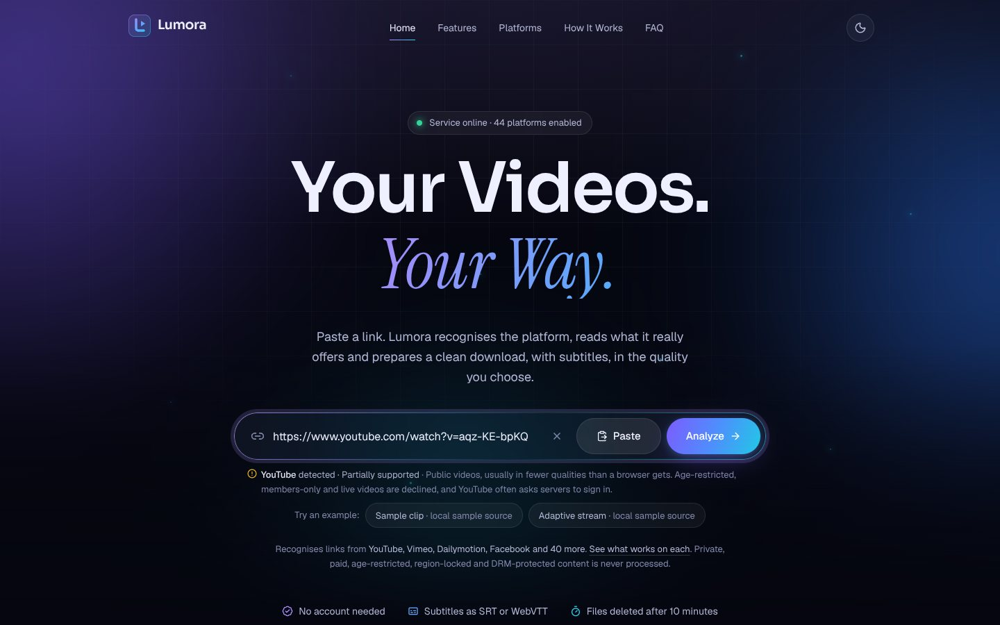
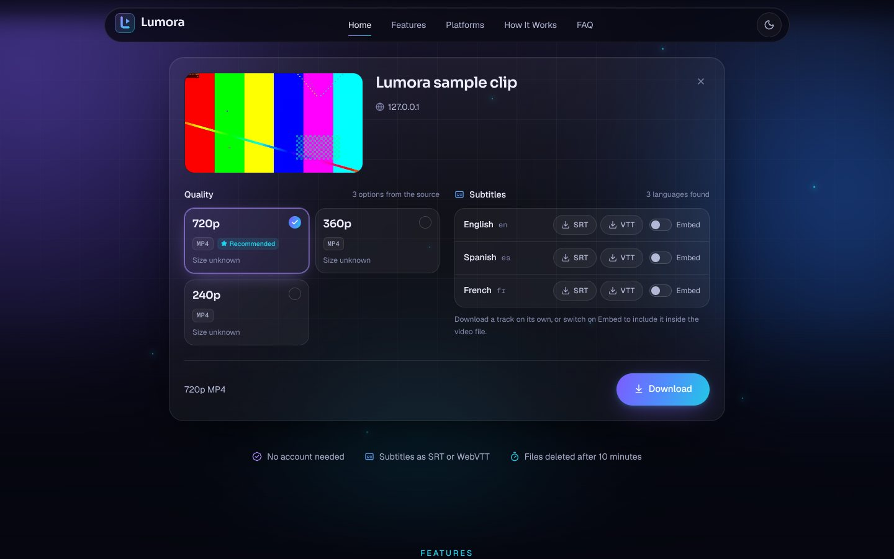
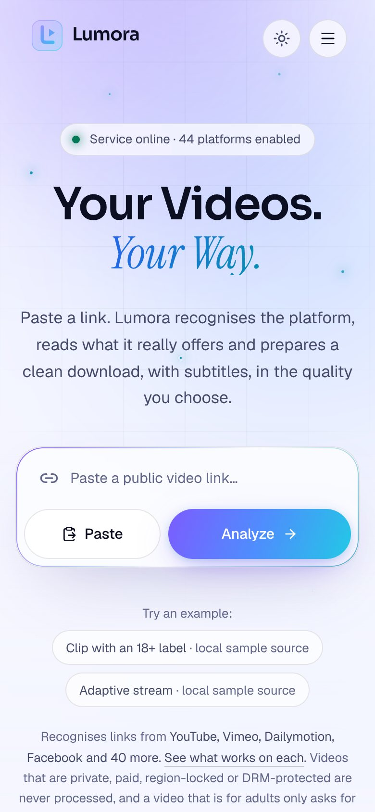

# Lumora

**Your Videos. Your Way.** Paste a link to a public video, choose a quality and subtitles, and download it.



Lumora is a complete application in two parts:

| Part | Folder | Built with | Runs on |
| --- | --- | --- | --- |
| Website | [`frontend/`](frontend) | React, TypeScript, Vite, Tailwind CSS, Framer Motion | Vercel (static) |
| API | [`backend/`](backend) | FastAPI, yt-dlp, FFmpeg | Any container host (a Render blueprint is included) |

The website is live at **<https://lumora-video.vercel.app>** and uses an API at `https://api.deephq.online`.
[Deploying](#deploying) explains how the two are hosted and connected, and [Testing](#testing) how the live
site is checked.

## Contents

- [What it does](#what-it-does)
- [Source policy](#source-policy)
- [Run it locally](#run-it-locally)
- [Deploying](#deploying)
- [Configuration](#configuration)
- [How it works](#how-it-works)
- [Security](#security)
- [API](#api)
- [Testing](#testing)
- [Limits and scaling](#limits-and-scaling)
- [Troubleshooting](#troubleshooting)

## What it does

- **Analyzes a link** and shows the title, preview image, duration and every quality the source really offers,
  with its format, codec and size. Nothing is invented: when a size is unknown it says so.
- **Downloads the quality you pick.** Sources that deliver video and audio separately are merged for you.
- **Subtitles.** Every published language is listed. Download a track as SRT or WebVTT, or embed tracks in the
  video file.
- **Real progress**: percentage, speed and time left as reported by the download, plus cancel at any moment.
- **Temporary files.** A finished file is deleted after a set time (30 minutes by default) or immediately with
  "Delete now". Nothing is kept after a restart.
- **Clear failures.** Private, paid, age-restricted, region-locked, DRM-protected and live content is declined
  with a specific message. So are invalid links and sources that are not enabled.
- **No account, no tracking.** No cookies, analytics or third-party scripts. Fonts are served by the site itself.
- Dark and light themes, phone to desktop layouts, keyboard and screen-reader support, reduced-motion support.



<p align="center">
  
</p>

<sub>Screenshots of the real application running locally. The analyzed clip comes from the sample source in
<a href="backend/scripts/sample_source.py"><code>backend/scripts/sample_source.py</code></a>, which is why its
source reads 127.0.0.1.</sub>

## Source policy

Out of the box Lumora only accepts links from an **allow list of sources that publish their videos for download
and reuse**:

| Source | Domain |
| --- | --- |
| Internet Archive | `archive.org` |
| Wikimedia Commons | `wikimedia.org` |
| media.ccc.de | `media.ccc.de` |
| NASA | `nasa.gov` |
| Blender Foundation | `blender.org` |

A link to any other site is declined with "This source isn't enabled on this service". This is deliberate.
Downloading from many well-known video platforms breaks their terms of service, and often copyright law,
unless you own the content or have permission. A public download service is responsible for what it serves.

You control the policy with environment variables on the API:

| Setting | Effect |
| --- | --- |
| `ALLOWED_DOMAINS=archive.org,example.org` | Replace the allow list (sub-domains are included). |
| `SOURCE_POLICY=open` | Accept every public source the extractor supports. |
| `BLOCKED_DOMAINS=example.com` | Always refuse these, in either mode. |

If you switch to `SOURCE_POLICY=open`, **you** are responsible for making sure each source you serve permits
downloading and that you have the rights to the content. Whatever the policy, Lumora never signs in, uses
cookies, bypasses paywalls, age gates, region locks or bot checks, and never circumvents DRM. Those requests
fail with an explanation.

## Run it locally

You need Python 3.11 or newer, Node.js 22 or newer, and FFmpeg.

**1. API**

```bash
cd backend
python3 -m venv .venv && source .venv/bin/activate
pip install -r requirements-dev.txt      # includes a bundled FFmpeg for machines without one
uvicorn app.main:app --reload            # http://127.0.0.1:8000
```

**2. Website**, in a second terminal

```bash
cd frontend
npm install
npm run dev                              # http://localhost:5173
```

The dev server forwards `/api` to the local API, so no further set-up is needed. Paste a link from one of the
allow-listed sources, or use the example buttons under the link field.

**Working offline, or without touching a real site.** The repository includes a sample source that serves
generated clips (colour bars and a tone) as a watch page, direct files, an HLS playlist and a DASH manifest,
with subtitles in three languages:

```bash
cd backend && source .venv/bin/activate
python scripts/sample_source.py          # prints the links it serves on http://127.0.0.1:8765
```

Then start the API with an exemption for exactly that address. This switch exists for development only and is
refused when `ENVIRONMENT=production`:

```bash
UNSAFE_ALLOW_HOSTS=127.0.0.1:8765 \
EXAMPLE_LINKS="Sample clip | local sample source | http://127.0.0.1:8765/watch/demo" \
uvicorn app.main:app --reload
```

## Deploying

The website is static and the API is a long-running process, so they are hosted separately.

### 1. API

The API cannot run as serverless functions: it needs FFmpeg, a writable disk, and downloads that run for
minutes. Use a host that runs a container. [`backend/Dockerfile`](backend/Dockerfile) builds the image and
[`render.yaml`](render.yaml) describes it for [Render](https://render.com):

1. In the Render dashboard choose **New > Blueprint**, select this repository and the branch that holds the
   code (normally `main`).
2. Render builds the image and gives the service an address such as `https://lumora-api.onrender.com`.
   Open `<address>/health`; it should answer `{"status":"ok", ...}`.

The blueprint asks for Render's **free** instance. That is enough to try Lumora out, and not more. This is
what [Render documents](https://render.com/docs/free) for it:

- 512 MB of memory and a tenth of a CPU core. An analysis costs a little under one CPU-second (measured
  locally), so expect it to take around ten seconds there.
- The service is stopped after 15 minutes without requests and takes about a minute to start again. The
  website says "Waking up the server" meanwhile and waits for up to two minutes.
- Render may suspend a free service that moves an unusually large amount of data, and a download service
  moves a lot. For regular use change `plan` in `render.yaml` to `0.5c-512mb` or larger, or pick another host.

The limits in the blueprint (one download at a time, files up to 512 MB, kept for 15 minutes) are cautious
starting points. **The blueprint has been checked against Render's documentation but not run on Render.**
Raise the limits on a larger instance.

**On your own server.** Any machine with Docker works, and so does any other container host (Fly.io,
Railway, Cloud Run with a single always-on instance):

```bash
docker build --tag lumora-api backend
docker run --detach --name lumora-api --restart unless-stopped \
  --publish 127.0.0.1:8000:8000 \
  --env ENVIRONMENT=production \
  --env ALLOWED_ORIGINS=https://lumora-video.vercel.app \
  --env TRUSTED_PROXY_HOPS=1 \
  lumora-api
```

- `ALLOWED_ORIGINS` is the address of the website. Browsers refuse the API's answers without it.
- The website is served over HTTPS, so the API must be too. Put a reverse proxy with a certificate in front
  of port 8000, for example [Caddy](https://caddyserver.com) with `api.example.com { reverse_proxy 127.0.0.1:8000 }`.
- `TRUSTED_PROXY_HOPS=1` tells the API that one proxy stands in front of it, so that limits apply per
  visitor and not to the proxy. Caddy passes the visitor's address on by itself; nginx needs
  `proxy_set_header X-Forwarded-For $proxy_add_x_forwarded_for;`. Use `CLIENT_IP_HEADER` instead only when a
  network such as Cloudflare sets such a header for you. [Configuration](#configuration) has the details.
- Behind Cloudflare's proxy, set `CLIENT_IP_HEADER=CF-Connecting-IP`, and know that every download then
  travels through Cloudflare. Its
  [terms for the Free, Pro and Business plans](https://www.cloudflare.com/service-specific-terms-application-services/#content-delivery-network-terms)
  require its paid media services for serving video through its network, and let it limit sites that do so
  without them. Setting the API's DNS record to "DNS only" avoids that; the server then needs its own
  certificate and `TRUSTED_PROXY_HOPS` instead of `CLIENT_IP_HEADER`.

### 2. Website

The Vercel project `lumora-video` builds the `frontend/` folder. Tell it where the API is:

1. In Vercel open **lumora-video > Settings > Environment Variables**.
2. Add `VITE_API_BASE_URL` with the API address, without a trailing slash, for the Production environment.
3. Redeploy (Deployments > the latest one > Redeploy). The address is compiled into the site at build time,
   so a redeploy is required whenever it changes.

Until that variable is set, the site says "Download service not connected yet" and makes no requests.

### 3. Check

Open the website. The pill above the headline should read "Service online". Click an example link, pick a
quality and download.

Or let a browser do it. This opens the site in Chrome, downloads a video through it and reports each step:

```bash
cd e2e && npm ci
node check-site.mjs https://lumora-video.vercel.app
```

If you later give the website a custom domain, add it to `ALLOWED_ORIGINS` on the API.

## Configuration

### API

Every setting has a safe default. [`backend/.env.example`](backend/.env.example) lists all of them with
comments; the ones you are most likely to change:

| Variable | Default | Purpose |
| --- | --- | --- |
| `ENVIRONMENT` | `development` | `production` turns off the test switches and requires explicit origins. |
| `ALLOWED_ORIGINS` | local dev addresses | Website addresses allowed to call the API, comma-separated. |
| `SOURCE_POLICY` | `allowlist` | `allowlist` or `open`. See [Source policy](#source-policy). |
| `ALLOWED_DOMAINS` | the five sources above | Domains accepted in `allowlist` mode. |
| `EXAMPLE_LINKS` | two open films | "Try an example" links: `Label \| Source \| URL` entries separated by `;`. |
| `MAX_FILE_SIZE_MB` | `2048` | Largest file the service will prepare. |
| `MAX_DURATION_SECONDS` | `14400` | Longest video accepted. |
| `MAX_CONCURRENT_JOBS` | `2` | Downloads running at once; the rest queue. |
| `FILE_TTL_SECONDS` | `1800` | How long a finished file is kept. |
| `RATE_LIMIT_ANALYZE` | `12/minute` | Analyses per visitor. Other limits are listed in `.env.example`. |
| `CLIENT_IP_HEADER` | unset | Header your platform sets to the visitor's address, e.g. `CF-Connecting-IP`. |
| `TRUSTED_PROXY_HOPS` | `0` | Alternative: number of proxies that append to `X-Forwarded-For`. |

Rate limits are per visitor, so the API must know the visitor's real address. Behind a proxy set exactly one
of the last two. If neither is set every visitor shares one limit.

### Website

| Variable | Purpose |
| --- | --- |
| `VITE_API_BASE_URL` | Address of the API, no trailing slash. Empty in development (requests use the dev proxy). |
| `VITE_CONTACT_EMAIL` | Optional. Address behind the "Contact" links; otherwise they open this repository's issues. |
| `DEV_API_PROXY_TARGET` | Development only. Where `/api` is forwarded; defaults to `http://127.0.0.1:8000`. |

`VITE_` variables are compiled into the public site. Never put a secret in one.

## How it works

```
Browser ──► Website (static, Vercel)
   │
   └──────► API (FastAPI) ──► one worker process per task ──► the source
                  │                 yt-dlp + FFmpeg
                  └── job state in memory, files on a temporary disk
```

1. **Analyze.** The API validates the link, then starts a short-lived worker process that reads the source's
   metadata with yt-dlp. The answer lists real qualities and subtitle tracks under opaque ids.
2. **Download.** The website starts a job with the chosen ids. A worker downloads the streams, FFmpeg merges
   them or embeds subtitles if asked, and the worker reports real progress, which the website polls.
3. **Save.** The finished file is streamed to the browser, with support for resuming. It is deleted when its
   time is up, on "Delete now", and when the server stops.

The API process never contacts a source itself. Each task runs in its own process so that a time-out or
"Cancel" can stop it completely, and so its network access can be restricted.

```
backend/
  app/
    main.py            app factory, middleware, error handling, housekeeping
    api/routes.py      the HTTP endpoints
    config.py          settings
    errors.py          every error code and its message
    security/          link validation, public-network rule, rate limits, file names
    services/          analyses, jobs, storage, FFmpeg, choosing qualities
    worker/            the isolated process that runs yt-dlp
  tests/               unit and integration tests, sample source, generated media
  scripts/             sample_source.py, live_smoke.py
frontend/
  src/
    lib/               API client, formatting, routing
    hooks/             the download state machine, service status, theme
    components/        layout, hero, processing states, sections
    pages/             Home, Privacy, Terms, 404
```

## Security

- **Link validation.** Only `http` and `https`, standard ports, no embedded credentials, no IP literals, no
  internal host names. The source policy is applied before anything is fetched.
- **No access to internal networks.** Every connection a worker opens is checked at socket level and refused
  unless the address is public. This also covers redirects, playlists and embedded pages that point somewhere
  internal, and DNS answers that change between the check and the connection. FFmpeg is not allowed network
  access at all.
- **Bounded work.** Limits on file size (also enforced by the operating system), duration, run time,
  concurrent and queued jobs, and jobs per visitor. Cancelling or timing out kills the whole process group.
- **Rate limits** per visitor on every endpoint, with `Retry-After`.
- **Opaque choices.** The browser never sends format strings or file paths, only ids issued by the analysis.
  File names shown to the user are sanitized.
- **Nothing sensitive leaves the server.** Errors use a fixed catalogue of messages; upstream error text and
  stack traces are only logged. Logs record a shortened visitor address.
- **Browser side.** A strict Content-Security-Policy, HSTS and related headers in
  [`frontend/vercel.json`](frontend/vercel.json); no inline scripts; no third-party requests.
- **Container.** Runs as a non-root user under an init process.

## API

Base path `/api/v1`. Errors have one shape: `{"error": {"code", "message", "hint"?, "retry_after"?}}`.
Interactive documentation is at `/docs` when `ENABLE_DOCS=true`.

| Method and path | Purpose |
| --- | --- |
| `GET /health` | Liveness, FFmpeg availability, job counts. |
| `GET /api/v1/config` | Limits, capabilities, enabled sources and example links. |
| `POST /api/v1/analyze` `{url}` | Analyze a link: title, duration, qualities, subtitles. |
| `GET /api/v1/analyses/{id}/thumbnail` | Preview image. |
| `GET /api/v1/analyses/{id}/subtitles/{track}?format=srt\|vtt` | One subtitle track as a file. |
| `POST /api/v1/jobs` `{analysis_id, quality_id, embed_subtitles[]}` | Start a download. |
| `GET /api/v1/jobs/{id}` | Status and progress. |
| `DELETE /api/v1/jobs/{id}` | Cancel a running job, or delete a finished file. |
| `GET /api/v1/jobs/{id}/file` | The finished file. Supports range requests. |

A `422` means the request itself cannot be fulfilled (a wrong, private or disallowed link), so repeating it
will not help. Anything that may succeed later uses `409`, `410`, `429` or `5xx`.

## Testing

```bash
cd backend && source .venv/bin/activate
python -m pytest        # unit and integration tests
ruff check . && mypy

cd frontend
npm run lint && npm run typecheck && npm test && npm run build
```

The integration tests run the real stack (the API, real worker processes, yt-dlp and FFmpeg) against the
local sample source, so they need no internet access and contact no third-party site.

[`ci.yml`](.github/workflows/ci.yml) runs on every push and pull request:

| Job | Checks |
| --- | --- |
| API | Lint, type-check and the full test suite on Python 3.11 and 3.12. |
| Website | Lint, type-check, unit tests and the production build. |
| API container image | Builds the image, starts it, checks health, FFmpeg, the non-root user, the source policy and a clean stop. |
| Real public sources | Analyzes and downloads the example links from the Internet Archive and Wikimedia Commons. |
| Live website | Opens the live site in Chrome and, for each example link: analyzes it, saves a subtitle track, downloads the video through the browser and deletes it from the server. |

The last two jobs depend on third-party sites and on the live deployment, so they do not run on ordinary
pushes. They run weekly, when started by hand from the Actions tab, or when a commit message contains
`[live-smoke]` or `[site-check]`.

- **Real public sources** tests the code in the repository. Run it yourself with
  `python scripts/live_smoke.py`, optionally followed by links to test.
- **Live website** tests what visitors get: the deployed site, the deployed API and the sources together. It
  is [`e2e/check-site.mjs`](e2e/check-site.mjs); the site's address is set in `ci.yml`. A failed weekly run
  means the live site needs attention.

Dependabot opens weekly update pull requests. **Keep yt-dlp current**: it follows the sites it supports, and
an old version is the usual reason a source stops working.

## Limits and scaling

The API is a single process by design. Job state lives in memory and files on local disk, so:

- Run **one instance with one worker process**. Two instances would not see each other's jobs.
- A restart or redeploy ends running downloads and removes finished files. Visitors see a clear message and
  can start again.
- Capacity is set by `MAX_CONCURRENT_JOBS`, memory and disk. Measured against the sample source, the API
  process used about 55 MB and each running task 55 to 80 MB. Allow more for complex sites.

To grow beyond one instance, move job records to a shared store such as Redis and finished files to object
storage. Each lives in one module (`services/jobs.py`, `services/storage.py`). Visitor identity is isolated in
`security/client.py`, which is where accounts would plug in.

## Troubleshooting

| What you see | Cause and fix |
| --- | --- |
| "Download service not connected yet" | `VITE_API_BASE_URL` was not set when the site was built. Set it and redeploy. |
| "Download service unreachable" | The API is down or its address is wrong. Open `<api>/health`. If that works, the website's address is missing from `ALLOWED_ORIGINS`. |
| "Waking up the server…" for a minute | Normal on hosts that sleep when idle. After two minutes the site gives up and offers "Retry". |
| "This source isn't enabled on this service" | The link's site is not on the allow list. See [Source policy](#source-policy). |
| "We couldn't reach the source" | The server has no route to that site, or the site is down. |
| A source that used to work now fails | Update yt-dlp in `backend/requirements.txt` and redeploy. |
| Everyone hits the rate limit together | The API cannot see visitor addresses. Set `CLIENT_IP_HEADER` or `TRUSTED_PROXY_HOPS`. |
| No merge or subtitle options | FFmpeg is missing. `/health` reports `"ffmpeg": false`. |
